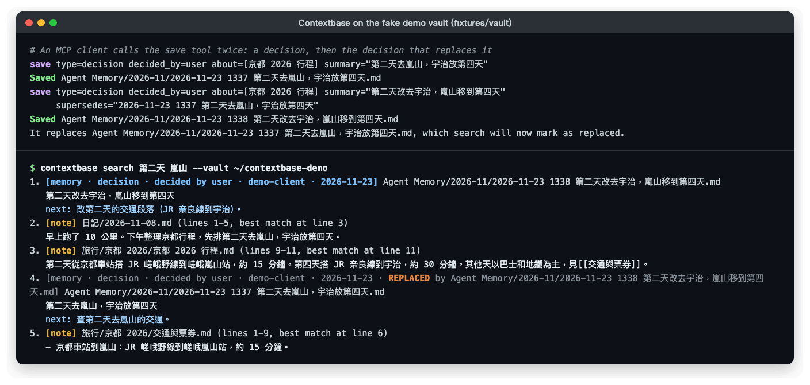
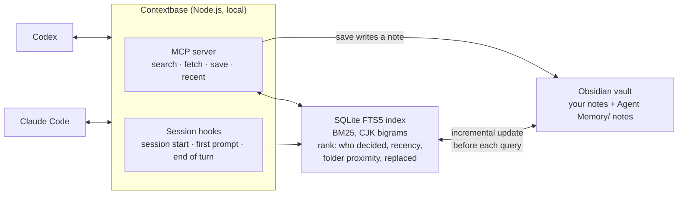

# Obsidian Contextbase

*An agent context system: shared memory for AI agents, kept as notes in your Obsidian vault.*



*Real output on the repository's fake demo vault (a Kyoto trip plan; note text is Chinese). An MCP client saves a decision, then a newer decision that replaces it. `contextbase search` puts the current decision first, above matching notes, and pushes the replaced one down with a REPLACED mark.*

**Claude Code, Codex and other AI agents pick up each other's decisions without hand-written handoff documents.** Contextbase is an MCP server (MCP, the Model Context Protocol, is the standard way agents call outside tools) plus session hooks. Agents save decisions and progress as ordinary Markdown notes in your vault, and any agent can find them again in a later session.

## What it does

- **One memory for several agents.** A decision Codex records can be retrieved by Claude Code in a new session, and the other way round.
- **Memories are plain notes.** Each memory is a Markdown note linked to the notes it is about, so you can read, edit or delete it in Obsidian.
- **Search that handles Chinese.** A SQLite FTS5 index with BM25 ranking covers your notes and the memories; Chinese, Japanese and Korean text is split into character pairs (bigrams), since these languages do not put spaces between words.
- **Ranking that knows about decisions.** Results are weighted by who decided (the user over an agent), recency and folder proximity, and a replaced decision is marked and sinks.
- **Reading and writing happen without being asked.** Hooks inject a digest of recent work when a session starts, pull related memories into the first prompt, and remind the agent to save after a turn that changed files.

## Architecture



Everything runs on your machine; no language model rewrites your notes and Contextbase makes no network requests.

## Status and limitations

- **Working:** the index, the four MCP tools, the three hooks and the installer, all covered by tests that pass in CI on Node.js 22, 24 and 26 ([workflow](.github/workflows/ci.yml)).
- **Not yet done:** the two-way demo with real agents (milestone M3, [script](docs/demo.md)) has not been recorded; the screenshot above uses a scripted MCP client on the fake vault, not a recorded agent session. The package is not on npm yet, and the lowest Node version claimed (22.13.0) has not been tried.
- **Retrieval is keyword-based.** BM25 finds words, not meaning; a larger retrieval evaluation and hybrid search are on the roadmap.
- The design is in [docs/plan.md](docs/plan.md), measurements in [docs/evaluation.md](docs/evaluation.md) and [docs/m0-findings.md](docs/m0-findings.md), prior art in [docs/related-work.md](docs/related-work.md) (all in Traditional Chinese).

## Quick start on the demo vault

After [installing from source](#install-from-source-for-now), try it on a copy of the fake vault in `fixtures/vault` without touching your own notes:

```bash
scripts/demo-setup.sh ~/contextbase-demo        # copy of the fake vault, no memories yet
contextbase search 嵐山 --vault ~/contextbase-demo
contextbase init --vault ~/contextbase-demo     # prints the changes; add --yes to apply
```

The full two-agent walkthrough is in [docs/demo.md](docs/demo.md) (Traditional Chinese).

## The problem

Coding agents already remember things, but each one keeps its memory to itself. Claude Code writes memory files under `~/.claude/projects/`, and Codex summarizes sessions into `~/.codex/memories/`. Neither agent can read the other's memory, and neither memory shows up in your notes.

So when you switch agents halfway through a task, you write a handoff document by hand: what is current, what was decided, what comes next. You end up carrying memory between two silos yourself.

## How it works

- **Memories are notes.** Each memory is a Markdown note in `Agent Memory/<year-month>/`, linked to the notes it is about, so it appears in Obsidian's backlinks. You can read, edit or delete it like any other note.
- **Index, don't compile.** No language model rewrites your notes. A BM25 full-text index (SQLite FTS5) covers your notes and the memories and updates incrementally before each query. Chinese, Japanese and Korean text is split into character pairs (or, as a setting, into dictionary words). The index lives in a hidden `.contextbase/` folder inside the vault that keeps itself out of Git; Obsidian Sync skips it, and deleting it only means it is rebuilt.
- **Ranking knows about decisions.** BM25 alone cannot tell an old decision from the one that replaced it. Results are therefore weighted by who decided (the user over an agent), how recent a memory is, and how close it is to the folder you work in; a replaced memory is marked and pushed down.
- **Write-back is checked and reminded.** Agents save with the `save` tool. Before writing, `about` must name real notes, a similar existing memory is shown back instead of being duplicated, and words you list stay out of memory. At the end of a turn that changed files, or after five turns without a save, a hook asks the agent once whether something should be saved.
- **Read-back is automatic.** A session-start hook injects what the memory is for and a short digest of recent work, grouped by topic. The first prompt of a session pulls in the memories most related to it. Agents can always `search` and `fetch`.

## Install (from source, for now)

Contextbase needs Node.js 22.13 or newer. CI runs the tests on the newest Node 22, 24 and 26 (22.23, 24.22 and 26.13 at the last run). The lowest version claimed, 22.13.0, has not been tried.

```bash
git clone https://github.com/DancinAndrew/obsidian-contextbase.git
cd obsidian-contextbase
npm install
npm pack
npm install -g ./obsidian-contextbase-0.0.0.tgz
```

Install from the packed file rather than with `npm install -g .`, which only links back to the clone.

Then install it for a vault. The first command only prints the changes it would make; the second applies them:

```bash
contextbase init --vault ~/path/to/vault
contextbase init --vault ~/path/to/vault --yes
```

- `--scope vault` (the default) installs for sessions started in the vault only; `--scope user` installs for every project, so that memories from code projects also land in the vault.
- In Codex, run `/hooks` once and trust the three Contextbase hooks. Codex skips untrusted hooks without a warning.
- `contextbase doctor --vault ~/path/to/vault` checks every piece, including whether the hooks have run.

## MCP tools

| Tool | What it does |
| --- | --- |
| `search` | Ranked search over memories and notes; each result has a path, line numbers and a snippet, and replaced memories are marked |
| `fetch` | Read a note or memory with line numbers, or one range of lines; refuses paths outside the vault and excluded folders |
| `save` | Write a memory note: a decision, progress or a fact, linked to the notes it is about. A similar memory comes back first: replace it with `supersedes`, or save anyway with `confirm` |
| `recent` | The latest memories that nothing replaced, grouped by topic or nearest to a folder |

## Hooks

| Hook | Claude Code and Codex event | What it does |
| --- | --- | --- |
| `session-start` | SessionStart | Injects what the memory is for and the recent-work digest |
| `prompt` | UserPromptSubmit | On a session's first prompt only, injects up to two related memories |
| `stop` | Stop | If the turn changed files, or five turns went by without a save, asks once whether to save |

## A memory note

```markdown
---
type: decision
summary: "Move Uji to day 2 and Arashiyama to day 4"
decided_by: user
agent: "codex"
cwd: "Travel/Kyoto 2026"
about:
  - "[[Kyoto 2026 itinerary]]"
supersedes: "[[2026-11-08 2105 Arashiyama on day 2]]"
created: 2026-11-09T14:32:00+08:00
---
Day 2 is only a half day, so the full-day Arashiyama trip moves to day 4.

**Next:** update the day 2 transport in the itinerary.
```

The server fills in `agent`, `cwd` and `created` itself. Opening "Kyoto 2026 itinerary" in Obsidian lists this memory among its backlinks.

## What a new session sees

```text
[Contextbase] Contextbase is the shared memory between the AI agents that work in this Obsidian vault (Claude Code, Codex and others). ...

[Contextbase] Recent work, by topic
Travel/Kyoto 2026
- 2026-11-09 decision (decided by the user, recorded by codex): Move Uji to day 2 and Arashiyama to day 4
  next: update the day 2 transport in the itinerary
  replaces 2026-11-08: Arashiyama on day 2, Uji on day 4
- 2026-11-09 progress (codex): Day 3 dinner not booked yet
  next: book once the day 3 schedule is fixed
Courses/Machine learning
- 2026-11-05 progress (claude-code): Preprocessing for the regularization assignment is done
  next: plot the two validation-error curves
Use the search tool for details. Notes in Agent Memory/ are append-only; do not edit them by hand.
```

The digest is computed from memory notes, stays under 1,500 characters, and never presents a replaced decision as current.

## Commands

| Command | What it does |
| --- | --- |
| `contextbase init` / `uninstall` | Install or remove Contextbase for Claude Code and Codex; prints the changes first |
| `contextbase doctor` | Check the index, both clients' settings, Codex's hook trust and when the hooks last ran |
| `contextbase search <words>` | Search from the terminal |
| `contextbase recent` | Print the digest a new session would see |
| `contextbase index` | Bring the index up to date and print counts |
| `contextbase exclude add <folder>` | Keep a folder out of the index and out of `fetch` |
| `contextbase serve` / `hook` | What the clients run; you do not call these yourself |

Every command takes `--vault <path>`, or reads `CONTEXTBASE_VAULT`.

## Configuration

`<vault>/.contextbase/config.json`:

```json
{
  "exclude": ["Private"],
  "saveDeny": ["salary"],
  "tokenizer": "bigram"
}
```

- `exclude`: folders kept out of the index and refused by `fetch`. Folders that start with a dot and `node_modules` are always skipped.
- `saveDeny`: a memory that mentions one of these words is not written.
- `tokenizer`: `bigram` (default) or `segmenter`. Changing it rebuilds the index.

## Privacy

Everything runs on your machine; Contextbase makes no network requests. Memories are ordinary notes in your vault, and the index stays in the vault's `.contextbase/` folder, out of Git and out of Obsidian Sync. A hook that fails exits quietly, so a broken setup never blocks your session.

## Uninstall

```bash
contextbase uninstall --vault ~/path/to/vault --yes
```

This removes only the entries `init` added. Memories stay in `Agent Memory/`, and the index stays in `.contextbase/` until you delete that folder.

## How it relates to existing tools

- **Built-in agent memories** (Claude Code, Codex) are automatic but private to each agent and invisible in your notes.
- **[claude-mem](https://github.com/thedotmack/claude-mem)** gives many agents an automatic shared memory, recorded by a second agent running alongside and stored under `~/.claude-mem`. Contextbase stores memory as notes in your vault and runs no extra model.
- **[basic-memory](https://github.com/basicmachines-co/basic-memory)** keeps knowledge in Markdown files with a local SQLite index, written when the agent calls its tools. Contextbase adds lifecycle hooks so that reading and writing happen without being asked, and it searches your existing notes as they are.
- **Obsidian MCP servers** (there are several) give agents read and write access to a vault but no memory model.
- **[qmd](https://github.com/tobi/qmd)** is a local search engine for Markdown and a model for the search side; it has no write path.
- **[OpenMemory MCP](https://mem0.ai/openmemory-mcp)** (Mem0) shares memory across MCP clients through a local service with a vector store and Postgres. Its memories live in that service's database rather than in your notes.
- **LLM Wiki-style vaults**, in which a language model compiles notes into wiki pages, sit one layer above. Contextbase records what happened and makes it findable; a wiki workflow can turn those memory notes into pages when you ask it to. Anthropic's [The components of agent memory](https://www.anthropic.com/research/components-of-agent-memory) describes the same layering, and in its experiments search and a wiki together beat either one alone.

## Roadmap

- [x] M0 Validate MCP and hook integration with Claude Code and Codex ([findings](docs/m0-findings.md))
- [x] M1 Core: vault scanner, CJK-aware tokenizer, incremental SQLite FTS5 index, ranking by relevance, recency and supersession, memory writer, CLI ([evaluation](docs/evaluation.md))
- [x] M2 The four tools, the session-start, first-prompt and end-of-turn hooks, one-command install
- [ ] M3 Cross-agent demo on a sample vault, in both directions ([script](docs/demo.md))
- [ ] Later: import built-in agent memories, a larger retrieval evaluation, hybrid search, Obsidian plugin

## License

[MIT](LICENSE)
