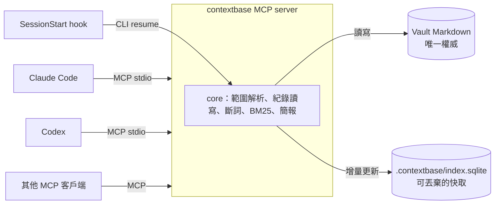

# 設計規劃與學習路線

> 草稿 v0，2026-11-09。這是邊做邊學的起點，不是定案。第 5 節的「待決定」討論後才定；定案的決定會用本專案自己的紀錄格式寫下來，當作第一批測試資料。

## 1. 目標

**一句話：** 任何 agent（Claude Code、Codex 或其他 MCP 客戶端）在 vault 的某個範圍開工時，自動拿到「這裡在做什麼、決定過什麼、下一步是什麼」；收工時把新的決定留下來。不必再手寫交接文件。

**MVP 驗收：** 下面三件事都要能示範。

1. 一個 MCP server（Model Context Protocol，讓 AI 客戶端用統一格式呼叫外部工具的協定）：把決定與脈絡存成 Obsidian 筆記，附連結與來源，並提供存入與 BM25 檢索。
2. Claude Code 與 Codex 接上同一個 server。
3. 跨 agent 接手：agent A 在一次工作中記下一個決定，這次工作不限寫程式，例如整理申請文件；agent B 在全新的 session 裡不讀任何交接文件，靠檢索取回這個決定並接著做。

## 2. 問題診斷

起點是一個真實的個人 vault：約 2,500 篇筆記、28 MB 的 Markdown，混合日記、旅行、閱讀與一個進行數月的申請專案。Claude Code 與 Codex 輪流維護它，整理方法採用 LLM Wiki（由 LLM 維護主題頁、附來源引用、記 append-only log）。

| 現象 | 規模 | 原因 |
| --- | --- | --- |
| 交接文件愈寫愈長 | 單份 342 行、34 KB | 寫的人猜不到接手者需要什麼，只好全寫 |
| 全域 log 淹沒專案細節 | 一條時間線 1,367 行、214 KB | 所有領域共用一份 log，專案細節和日常整理混在一起 |
| index.md 不夠用 | 約 2,500 篇 | LLM Wiki 原文說 index.md 在「約 100 份來源、數百頁」的規模好用，再大就需要搜尋 |
| 專案自己長出入口 | 「助理入口」「接續工作」「追蹤紀錄」三篇 | 已經手動發明了「範圍」，只是沒有程式幫忙維護 |
| 先前做的全文索引停用 | 19,388 個片段 | 索引裡的路徑停在資料夾重整前；停用原因待確認 |

把一份交接文件拆開，內容大致分七類：

1. 目前版本與狀態：哪份最新、哪些已過期
2. 檔案地圖與閱讀順序
3. 已確認與待確認的決定
4. 事實與來源
5. 下一步
6. 權限與限制：agent 可以做、不可以做什麼
7. 驗收方式

第 2、4、6、7 類屬於範圍本身，很少變；第 1、3、5 類是增量，每次工作只變一點。所以交接文件大部分是在重新組裝已經存在的東西。

> **結論：交接應該是一個查詢（view），不是一份文件。**

## 3. 核心概念

### 3.1 記憶有四種，生命週期不同

| 類型 | 在 agent 系統裡 | 在這個 vault 裡 | 特性 |
| --- | --- | --- | --- |
| 工作記憶 | context window | 這次對話 | 昂貴、會被壓縮、session 結束就消失 |
| 語意記憶：什麼是真的 | 知識庫 | LLM Wiki 主題頁 | 長期、要有來源、會被改寫 |
| 情節記憶：發生過什麼 | 事件紀錄 | wiki log、交接文件 | append-only、量大、愈舊愈不相關 |
| 程序記憶：怎麼做 | 指示與技能 | AGENTS.md、skills | 很少變、每次都要載入 |

分類取自 CoALA（Sumers et al., 2023, *Cognitive Architectures for Language Agents*）。LLM Wiki 處理語意記憶；交接卡住的是情節記憶與「目前狀態」。兩者擠在同一套 index 和 log 裡，才會互相淹沒。Contextbase 補的是後者，不取代 LLM Wiki。

### 3.2 Push 與 pull

交接文件是 push：寫的人替接手者決定要讀什麼。Notion MCP 是 pull：接手者自己問。Pull 要成立需要兩件事：一份很短的起點，加上可以搜尋。

### 3.3 真實來源與衍生視圖

Markdown 是唯一權威。索引與交接簡報都是隨時可以重建的衍生物，就像資料庫的 table 與 view。由此推出兩條實作規則：

- 索引壞了或過期了，刪掉重建即可，不會傷到資料。
- 索引必須自己跟上檔案的變化：每次查詢前比對檔案修改時間，做增量更新。不能依賴有人記得去跑「重建索引」，否則資料夾一搬家，索引就停在舊路徑。

### 3.4 用範圍繼承，取代巢狀 wiki

不要維護「外層一套、內層一套」wiki，改成一套機制、多個範圍：

- 根目錄只做路由：有哪些範圍、全域規則是什麼。
- 每個範圍有自己的說明（目的、規則、閱讀順序）、目前狀態與決定。
- 規則由外往內繼承，就像 CLAUDE.md 與 AGENTS.md 的目錄階層，或 CSS 的 cascade。
- 檢索預設在目前範圍內，需要時才往外擴。

外層不需要知道內層的細節，只需要知道「那裡有一個範圍、在做什麼、最近一次活動是何時」。

```text
vault/                          ← 根：全域規則與範圍清單
├── 10_日誌/                     ← 不是範圍：一般筆記，照常可以被搜到
├── 20_職涯/
│   └── 申請/                    ← 範圍：申請（共用方法、個人素材）
│       └── 學程A/               ← 範圍：學程A，繼承「申請」的規則
│           ├── 00_入口.md       ← 範圍說明，用 frontmatter 標記
│           └── _context/
│               ├── state.md    ← 目前狀態，可覆寫的快照
│               ├── log.md      ← 事件時間線，append-only
│               └── decisions/  ← 一個決定一篇筆記
└── 40_生活/旅行/京都2026/        ← 另一個範圍
```

### 3.5 漸進揭露

`resume` 只給 1–2K tokens 的簡報加上連結，細節等 agent 需要時再搜、再讀。這和 Claude Code skills（先載入描述，用到才讀全文）、claude-mem 的三層（索引、時間線、細節）是同一個想法。

### 3.6 為什麼先用 BM25

- vault 裡充滿精確字串：版本號（v6）、課號、日期、檔名、百分比。embedding 對這類字串不可靠，BM25 能精確命中。
- 不需要模型、可以離線、結果可以重現，也能解釋為什麼命中。
- agent 會自己換關鍵字重搜（agentic search），補上 BM25 不懂同義詞的缺點。

**中文要先斷詞。** 以「把交接文件變成可以查詢的脈絡資料庫」為文件，在 SQLite FTS5 實測：

| 查詢 | `unicode61`（預設） | `trigram` |
| --- | --- | --- |
| 交接 | 0 筆 | 0 筆 |
| 交接文件 | 0 筆 | 1 筆 |
| 脈絡資料庫 | 0 筆 | 1 筆 |

`unicode61` 把一整串中文當成一個 token，所以什麼都查不到；`trigram` 至少要三個字，查不到「交接」「脈絡」這類兩字詞，而兩字詞正是中文最常見的長度。可行的做法有兩個：

- **中日韓 bigram**：每兩個相鄰的字當一個 token，是 Lucene CJKAnalyzer 的做法，先前停用的索引用的就是它。
- **`Intl.Segmenter`**：Node 與 Obsidian 都內建，用 ICU 字典斷詞。實測結果：「把｜交接｜文件｜變成｜可以｜查詢｜的｜脈絡｜資料庫」。

斷好詞以後，以空白串起再交給 FTS5，就能直接用它內建的 `bm25()` 排序。兩種斷詞法用評測集比較後再定。之後要加向量檢索，就用 reciprocal rank fusion（RRF，按名次倒數加總來合併多份排名）。

### 3.7 MCP 的三種能力

| 能力 | 誰觸發 | 這裡的用途 |
| --- | --- | --- |
| Tools | 模型自己決定呼叫 | `search`、`record`、`resume` |
| Resources | 客戶端應用程式附加 | 範圍說明、目前狀態等唯讀資料 |
| Prompts | 使用者觸發，Claude Code 會顯示成 slash command | `/resume`、`/checkpoint` |

傳輸用 stdio：客戶端把 server 當子程序啟動，透過 stdin 與 stdout 交換 JSON-RPC 訊息。

MCP 不是大腦，而是交付層：同一套功能可以被 Claude Code、Codex、Claude Desktop 等任何客戶端使用，而且輸入有 schema 規範，紀錄格式才會一致。真正的價值在範圍、紀錄格式與檢索。

### 3.8 Hooks：讓交接自動發生

Claude Code 與 Codex 都有 SessionStart hook，hook 的輸出會被注入成 agent 的上下文，所以「開工先讀簡報」不必靠人記得。Codex 的 hooks 依第三方整理自 v0.124 起穩定，實作前以官方文件確認。收工端（Stop、PreCompact、SessionEnd）可以提醒 agent 先記下決定再結束。

## 4. 架構草案



### 4.1 元件

| 元件 | 職責 |
| --- | --- |
| core | 範圍解析、紀錄讀寫、斷詞、索引與 BM25、簡報組裝 |
| CLI | `index`、`search`、`resume`，除錯用，也給 hooks 呼叫 |
| MCP server | 把 core 包成 tools 與 prompts 的薄層 |
| Obsidian 外掛（之後） | 範圍儀表板與決定時間線；之後評估把 MCP server 放進外掛 |

### 4.2 資料模型

全部是 Markdown，人和 agent 讀的是同一份。

**範圍說明：** 在既有的入口筆記加檔頭欄位，不改正文。

```yaml
---
type: index
cb-scope: true          # 這個資料夾是一個範圍；id 預設用資料夾路徑
cb-read-first:          # 接手時先讀
  - "[[申請文件/CV]]"
---
```

**目前狀態：** `_context/state.md`，可覆寫的快照，內容是現在在做什麼、下一步、卡在哪、等使用者回答什麼。歷史由 git 保存。

**決定：** `_context/decisions/` 下一個決定一篇筆記。

```markdown
---
cb-kind: decision
status: confirmed        # proposed | confirmed | superseded
decided_by: user         # user | agent
agent: codex
created: 2026-11-09T14:20
supersedes: "[[2026-11-02 京都住宿訂在京都車站]]"
---
交通比價後選四條烏丸：到兩個主要景點都不用轉車。^[40_生活/旅行/京都2026/住宿比較.md:12-30]
```

- `decided_by` 和 `status` 區分「使用者已確認」與「agent 提議」，因為模型的建議不等於使用者的承諾。Obsidian 的 Bases 可以直接列出整個 vault 裡所有 `status: proposed` 的決定，當成待確認清單。
- 來源用帶行號的引用，和 LLM Wiki 的引用規則一致。
- 舊決定只會被新決定取代（`supersedes`），不改寫。

**事件：** `_context/log.md`，append-only，沿用 LLM Wiki 的慣例，每筆以 `## [日期 時間] 類型 | 標題` 開頭，方便用 grep 查最近幾筆。事件不需要被單獨連結，所以可以全放一個檔；決定需要被連結與取代，所以一篇一檔。標題裡的 `|` 會和 Obsidian 連結的別名語法衝突，這也是決定不放在 log 標題裡的原因之一。

### 4.3 MCP 工具草案

| 工具 | 輸入 | 輸出 |
| --- | --- | --- |
| `resume` | `scope?`，省略時從工作目錄推斷 | 簡報：範圍目的與規則、先讀清單、目前狀態、待使用者回答、最近的決定與事件、上下層範圍 |
| `search` | `query`、`scope?`、`kinds?`、`limit?` | 排名結果：路徑、標題、行號區間、摘錄、分數、所屬範圍 |
| `record` | `kind`（decision、checkpoint 或 question）、`scope`、`title`、`body`、`decided_by`、`evidence?`、`supersedes?` | 寫入位置與可直接貼上的連結 |
| `scopes` | 無 | 範圍樹、每個範圍一句話目的、最近活動時間 |

Prompts：`resume` 用於開工；`checkpoint` 用於收工前，請 agent 記下決定並更新狀態。

## 5. 待決定

| # | 問題 | 選項 | 目前傾向 |
| --- | --- | --- | --- |
| D1 | 語言 | TypeScript 或 Python | **TypeScript**：Obsidian 外掛只能用 TS，core 可以共用；Node 內建 SQLite（含 FTS5 與 `bm25()`）和 `Intl.Segmenter`，不需要原生套件。外掛端能否使用 `node:sqlite` 要另外驗證 |
| D2 | 紀錄放哪 | 各範圍的 `_context/`，或集中在一個資料夾 | **各範圍**：細節留在所屬領域，不被全域淹沒 |
| D3 | 決定的粒度 | 一個決定一篇筆記，或寫進 log 的一個標題 | **一篇一檔**：可以連結、可以被取代、可以用 Bases 列出待確認清單；事件仍寫進 log |
| D4 | 索引範圍 | 整個 vault 扣掉排除清單，或只索引紀錄 | **整個 vault**：決定要能和原始筆記一起被搜到；封存、附件與敏感資料夾預設排除 |
| D5 | 寫入要多自動 | agent 明確寫入、開工時自動讀；或像 claude-mem 由第二個模型自動摘要整個 session | **明確寫入加自動讀**：自動摘要容易把模型推論混成事實 |

## 6. 路線圖

| 里程碑 | 目標日期 | 要做的 | 學到的 | 要能回答的問題 |
| --- | --- | --- | --- | --- |
| M0 設計 | 11/10 | 定 D1–D5；寫一個只有一個工具的 MCP server，接上 Claude Code 與 Codex | MCP 的資料流、stdio、兩個客戶端的設定方式 | MCP 的 tools、resources、prompts 差在哪？ |
| M1 core | 11/13 | 範圍解析、紀錄讀寫、斷詞、FTS5 索引、CLI；用假資料 vault 寫測試 | BM25 公式（k1、b、IDF）、FTS5、增量索引 | 為什麼用 BM25 而不是 embedding？中文怎麼斷詞？ |
| M2 MCP | 11/15 | 四個工具、兩個 prompts、兩個客戶端的設定檔 | 工具描述要怎麼寫，agent 才會在對的時機呼叫 | 記憶怎麼在不同 agent 之間共享？ |
| M3 示範 | 11/18 | 在真實 vault 跑跨 agent 接手；錄示範；英文 README | 端到端驗收 | 和直接用 basic-memory 有什麼不同？ |
| M4 之後 | 無 | hooks 自動化、評測集、混合檢索、Obsidian 外掛、上架 | 檢索評估方法、外掛開發與發佈 | 怎麼證明檢索變好了？ |

### 學習方式

每個里程碑都走同一個循環：

1. 先講概念，對照現有專案怎麼做（見 [related-work.md](related-work.md)）。
2. 一起做決定，寫成決定紀錄。
3. agent 寫骨架與測試；核心函式（例如 BM25 排序、範圍解析）由人親手寫，或逐行講解。
4. 寫一段「我能講清楚」的筆記：做了什麼、為什麼、取捨是什麼。

## 7. 風險與原則

- **時程：** M3 要在 11/18 前完成，M4 全部排在之後。
- **隱私：** 這個 repo 公開，只放程式與假資料。測試用 `fixtures/` 裡的假 vault，不放任何真實筆記。
- **敏感資料夾：** 排除清單預設生效；索引檔放在 vault 的 `.contextbase/`，不進 git。
- **多個 agent 同時寫：** log 只 append；state 覆寫前先比對版本，參考 project-continuity 的 writer lease。
- **不重蹈舊索引的覆轍：** 索引自己跟上檔案變化，檔案搬家後的下一次查詢就會修正。
