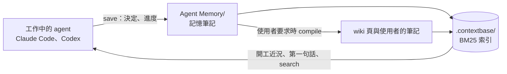
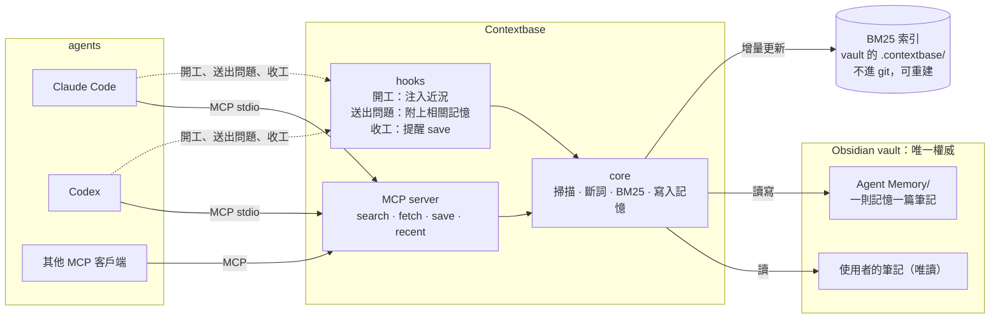
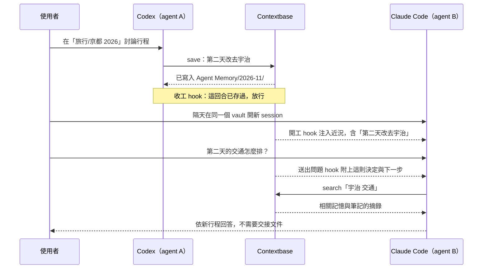

# 設計規劃與學習路線

> 草稿 v1，2026-11-09；11/11、11/12 更新。取代 v0「每個資料夾一套 `_context/`」的設計：v0 只適合作者自己的 vault，別人裝了還得先替每個資料夾建結構。v1 的目標是像 Notion MCP 一樣，裝了就能用。第 6 節是已經討論定案的決定，第 7 節列還要一起決定的事（目前沒有）。
>
> 11/11 補上：做出來之後看得到什麼（1.1）、為什麼不只用 grep（3.6）、和 LLM Wiki 的關係（3.8）、在 vault 根目錄開工時看不出範圍的問題（5.5），以及參考其他記憶系統後的四個改進（D7–D10）。同一天，D1–D10 依建議全部定案（第 6 節）。

## 1. 目標

**一句話：** Claude Code、Codex 和其他 MCP 客戶端共用一份記憶。這份記憶就是 Obsidian vault 裡的普通筆記：agent 自動寫、自動讀，使用者不必寫交接文件，也不必維護任何結構。

**MVP 驗收：** 下面三件事都要能示範。

1. 一個 MCP server（Model Context Protocol，讓 AI 客戶端用統一格式呼叫外部工具的協定）：把決定與脈絡存成互相連結的 Obsidian 筆記，並提供 BM25 檢索。
2. Claude Code 與 Codex 都接上同一個 server，用一行指令裝好。
3. 跨 agent 接手：agent A 在一次工作中記下一個決定，這次工作不限寫程式，例如規劃旅行；agent B 在全新的 session 裡不讀任何交接文件，就拿到這個決定並接著做。

### 1.1 做出來之後，看得到什麼

使用者不會多一個搜尋框：自己找筆記，用 Obsidian 的搜尋就夠了。索引是給 agent 用的，使用者實際得到的是下面三件事。

**一、開新 session 時，agent 先收到一段近況。** 內容就是交接文件該有的三件事：目前的決定、做到哪、下一步。下面是用 15 篇假筆記實際跑出來的結果。工作資料夾是 vault 根目錄，看不出主題，所以依主題分組：

```text
[Contextbase] 最近的工作，依主題分組
旅行/京都 2026
- 11/09 進度：第三天晚餐還沒訂，候選在餐廳清單（codex）
  下一步：確認第三天的行程時間後預約。
- 11/09 決定：第二天改去宇治，嵐山移到第四天（使用者決定，codex 記錄）
  下一步：更新行程表第二天的交通。
  已被取代：11/08 第二天去嵐山，第四天去宇治
課程/機器學習
- 11/05 進度：正則化作業的資料前處理完成（claude-code）
  下一步：畫出兩條驗證誤差曲線。
需要細節時用 search；Agent Memory/ 只新增、不手改。
```

整段約 280 字，是從記憶筆記查出來的，不必有人寫。它取代的是 2.1 節那份 34 KB 的交接文件。實際注入時，最前面還會多一段固定的說明（約 100 個 token）：這份記憶是做什麼的、什麼時候該用 `save` 存（D11）；上面的範例只列出近況的部分。

**二、問第一句話時，相關的記憶自動附上（D7）。** 使用者問「第二天的交通怎麼排？」，agent 在回答前就收到「11/09 決定：第二天改去宇治，嵐山移到第四天；下一步：更新行程表第二天的交通」。agent 不必自己想到要去查，也不會拿到已被取代的舊決定。

**三、筆記上看得到決定的來龍去脈。** 在 Obsidian 打開「京都 2026 行程」，反向連結面板會列出和它有關的每一則記憶：哪個 agent、哪天、決定了什麼、為什麼。

## 2. 問題

### 2.1 現象

起點是一個真實的個人 vault：約 2,500 篇筆記，由 Claude Code 與 Codex 輪流維護。每次換 agent 都要先寫一份交接文件，單份可以長到 34 KB，因為寫的人猜不到接手者需要什麼，只好全寫。

### 2.2 診斷：每個 agent 的記憶各自分開

兩個 agent 其實都已經有自動記憶，只是各存各的：

| agent | 存在哪裡 | 誰、何時寫 | 怎麼讀回來 |
| --- | --- | --- | --- |
| Claude Code | `~/.claude/projects/<專案>/memory/`：一則一檔，加一份 `MEMORY.md` 索引 | agent 在對話中自己判斷 | 每次開工載入 `MEMORY.md`，需要時讀單則 |
| Codex | `~/.codex/memories/`：每個 session 一份摘要，合併成 `MEMORY.md`，再濃縮成 `memory_summary.md` | session 結束後在背景整理 | 從結構推測是開工讀濃縮摘要，需要時查 `MEMORY.md` |

以上是 2026-11 在 Codex 0.163 與 Claude Code 2.1 上觀察到的結構。Codex 的是內部格式，同一台機器上已經同時存在 `memories/` 與 `memories_v2/` 兩版。

所以問題不是「沒有記憶」：

- 兩套記憶互相看不到。
- 使用者在 Obsidian 裡看不到，也改不了。
- 換 agent 時，交接文件就是使用者親手把記憶從一邊搬到另一邊。

> **結論：缺的不是另一套記憶，而是一份共用的記憶。交接應該是一個查詢，不是一份文件。**

## 3. 核心概念

### 3.1 記憶系統的三個零件

任何 agent 記憶系統都可以拆成三個問題：

1. **存在哪裡**（store）
2. **誰、在什麼時候寫**（write path）
3. **怎麼讀回來**（read path）：通常兩種並用。開工時先塞一小段摘要（push），需要細節時再搜（pull）。

| 系統 | 存在哪裡 | 誰、何時寫 | 怎麼讀回來 |
| --- | --- | --- | --- |
| Claude Code、Codex 內建 | 各自的本機資料夾 | 見 2.2 | 見 2.2 |
| claude-mem | 本機 `~/.claude-mem` | 旁邊另跑一個 agent，邊看邊做筆記 | 開工注入短索引，需要時取細節 |
| basic-memory | Markdown 檔加本機 SQLite 索引 | agent 呼叫寫入工具 | agent 呼叫搜尋與讀取工具 |
| Notion MCP | Notion workspace | agent 呼叫建立、更新頁面的工具 | agent 呼叫搜尋與讀取工具 |
| **Contextbase** | **vault 裡的 `Agent Memory/`，索引在 vault 的 `.contextbase/`** | **agent 呼叫 `save`，收工 hook 補漏** | **開工與第一句話時注入，需要時 `search`、`fetch`** |

各系統的差別只在這三個零件怎麼選。Contextbase 的選擇是：存在使用者看得到的地方、寫入不靠另一個模型、讀取兩種並用。

### 3.2 Notion MCP 怎麼運作

Notion MCP 是產品形態的參考：裝了就能用，工具分成搜尋與讀取。記憶本身怎麼寫、怎麼讀、怎麼保持正確，參考的是其他記憶系統，見 3.8 節與 [related-work.md](related-work.md)。Notion MCP 由三個零件組成：

1. **共用的資料：** workspace 裡的頁面與資料庫。
2. **自動維護的搜尋索引：** 由 Notion 的伺服器負責更新。
3. **Notion 自己架的 MCP server**（`https://mcp.notion.com/mcp`）：用 OAuth 登入，使用者什麼都不用裝。agent 可以用大約 15 個工具，核心是 `notion-search`、`notion-fetch`、`notion-create-pages`、`notion-update-page`。

Notion MCP 本身不記得任何東西。agent A 寫了一頁，agent B 搜得到這一頁，記憶就產生了。**共用的資料、自動索引、讀寫工具，三者加起來就是共享記憶。** Contextbase 把同一個結構搬到本機：資料是 vault 裡的 Markdown，索引在本機，工具一樣是搜尋、讀取、寫入。

### 3.3 索引，不是 compile

| | compile（LLM Wiki 的做法） | 索引（Notion、搜尋引擎的做法） |
| --- | --- | --- |
| 誰做 | LLM 一篇篇讀，寫出新的整理頁 | 程式建一張「哪個詞出現在哪篇、哪一行」的查找表 |
| 成本 | 花 token、慢 | 不用模型；約 2,500 篇預估幾秒，M1 實測 |
| 產出 | 新內容，之後也要維護 | 使用者看不到也不用管，壞了刪掉重建 |
| 檔案改了 | 要重新 compile | 只重建改過的那一篇 |

Contextbase 只做索引。LLM Wiki 的 compile 和 Contextbase 不衝突：兩者是記憶的不同層，見 3.8 節。

### 3.4 真實來源與衍生物

Markdown 是唯一權威，索引是隨時可以重建的衍生物，就像資料庫的 table 與 view。由此推出兩條實作規則：

- 索引壞了或過期了，刪掉重建即可，不會傷到資料。
- 索引必須自己跟上檔案的變化：每次查詢前比對檔案修改時間，做增量更新。不能依賴有人記得去跑「重建索引」，否則資料夾一搬家，索引就停在舊路徑。作者先前做過的一份全文索引，路徑就停在一次資料夾重整之前。

### 3.5 記憶有四種

CoALA（Sumers et al., 2023, *Cognitive Architectures for Language Agents*）把 agent 的記憶分成四種：

| 類型 | 在 agent 系統裡 | 在 Contextbase 裡 |
| --- | --- | --- |
| 工作記憶 | context window | 不處理：就是這次對話 |
| 情節記憶：發生過什麼 | 事件紀錄 | `type: progress`：做到哪、卡在哪、下一步 |
| 語意記憶：什麼是真的 | 知識庫 | `type: decision`、`type: fact`，加上使用者自己的筆記 |
| 程序記憶：怎麼做 | 指示與技能 | 不處理：AGENTS.md、CLAUDE.md、skills |

### 3.6 為什麼用 BM25

- 筆記與記憶裡充滿精確字串：檔名、版本號、日期、人名、專有名詞。embedding 對這類字串不可靠，BM25 能精確命中。
- 不需要模型、API key 或 GPU：一行就能裝、可以離線、資料不出本機；結果可以重現，也能解釋為什麼命中。
- agent 會自己換關鍵字重搜（agentic search），補上 BM25 不懂同義詞的缺點。
- 弱點是同義詞（「交接」與「接手」）與跨語言（用英文查中文筆記）。之後用評估集量化；真的需要時再加向量檢索，用 reciprocal rank fusion（RRF，按名次倒數加總來合併多份排名）合併兩份排名。

**為什麼不直接用 grep？** agent 本來就會用 grep 搜檔案，使用者也有 Obsidian 的搜尋，所以 BM25 多給了什麼要說清楚。用 1.1 節那 15 篇假筆記實測：

| 查詢 | grep | BM25 |
| --- | --- | --- |
| 「宇治 交通」 | 0 行：字面上沒有這一整串 | 兩個詞分開比對，命中 9 篇並依相關度排名 |
| 「交通」 | 10 行、8 篇，依檔案順序列出，包括機器學習筆記裡的「交通流量資料集」 | 這個詞出現在超過一半的筆記，IDF 為 0，自動不計分 |
| 排名 | 沒有 | 「宇治」少見所以權重高，標題命中再加權 |
| 新舊決定 | 「第二天去嵐山」與「第二天改去宇治」並列，看不出哪個是現況 | 結果附上記憶的類型與「已被取代」 |

不過 BM25 自己也分不出新舊：問「第二天的交通怎麼排？」時，新舊兩則決定的分數是 3.43 對 3.39，幾乎一樣。所以排名還要加上取代關係與新近度（D8）。

BM25 的定位因此是「有排名、帶記憶後設資料的 grep」，不是取代 grep，agent 仍然可以自己 grep。兩個外部例子指向同一件事。Claude Code 團隊早期試過向量資料庫，後來改成讓 agent 自己用 grep 搜尋，理由是更簡單、沒有索引過期與權限的問題。Letta 只給 agent 檔案工具，在 LoCoMo 這個長期對話記憶的測驗拿到 74.0%，高於 Mem0 當時公布的 68.5%；這是 Letta 自己測的，Mem0 後來公布了更高的分數。**檢索方法沒有想像中重要，重要的是該記的有沒有寫下來，以及 agent 會不會去看。** 所以 Contextbase 的重點放在自動寫入與主動注入，BM25 是讓這兩件事便宜又準的工具。來源見 [related-work.md](related-work.md)。

BM25 的公式有三個重點：詞頻的效果會飽和（參數 k1）、長文件要打折（參數 b）、少見的詞比常見的詞重要（IDF）。

一個實驗上的提醒：語料只有兩篇、查詢詞出現在其中一篇時，IDF = log((2 − 1 + 0.5) ÷ (1 + 0.5)) = log(1) = 0。FTS5 會把非正的 IDF 換成極小的正數，所以實測分數是 −0.000001（FTS5 的 `bm25()` 回傳負值，越小越相關）。1.1 節的 15 篇示範裡，「交通」出現在 8 篇、超過一半，IDF 也變成 0。檢索評估一定要用接近真實規模的語料。

**中文要先斷詞。** 以「把交接文件變成可以查詢的脈絡資料庫」為文件，在 SQLite FTS5 實測：

| 查詢 | `unicode61`（預設） | `trigram` |
| --- | --- | --- |
| 交接 | 0 筆 | 0 筆 |
| 交接文件 | 0 筆 | 1 筆 |
| 脈絡資料庫 | 0 筆 | 1 筆 |

`unicode61` 把一整串中文當成一個 token，所以什麼都查不到；`trigram` 至少要三個字，查不到「交接」「脈絡」這類兩字詞，而兩字詞正是中文最常見的長度。可行的做法有兩個：

- **中日韓 bigram：** 每兩個相鄰的字當一個 token，是 Lucene CJKAnalyzer 的做法，作者先前那份全文索引用的就是它。
- **`Intl.Segmenter`：** Node 與 Obsidian 都內建，用 ICU 字典斷詞。實測結果：「把｜交接｜文件｜變成｜可以｜查詢｜的｜脈絡｜資料庫」。示範句「第二天改去宇治，嵐山移到第四天」切成「第二｜天｜改｜去｜宇治｜嵐山｜移到｜第四｜天」：地名切對了，「第二天」被拆開；bigram 則是「第二、二天、天改、改去、去宇、宇治……」。

斷好詞以後以空白串起再交給 FTS5，就能直接用內建的 `bm25()` 排序；查詢也用同一套斷詞。兩種做法在 M1 用小型評估集比較後再定。

### 3.7 MCP 與 hooks

MCP server 能提供三種能力：

| 能力 | 誰觸發 | 這裡的用途 |
| --- | --- | --- |
| Tools | 模型自己決定呼叫 | `search`、`fetch`、`save`、`recent` |
| Resources | 客戶端應用程式附加 | MVP 不用 |
| Prompts | 使用者觸發，Claude Code 會顯示成 slash command | 之後再加，例如 `/checkpoint`：現在就存 |

傳輸用 stdio：客戶端把 server 當子程序啟動，透過 stdin 與 stdout 交換 JSON-RPC 訊息。每個 session 各自啟動一個 server 程序，所以 Claude Code 與 Codex 同時開著時，會有兩個程序共用同一個索引檔（見第 9 節）。MCP 握手時客戶端會報上自己的名字（`clientInfo`），所以 `save` 不必讓 agent 自己說「我是誰」。M0 實測的名字是 `claude-code` 與 `codex-mcp-client`，需要一張對照表（5.3 節）。

Hooks 是客戶端在生命週期的固定時間點執行的指令，讓讀寫不必靠人記得：

- **SessionStart（開工）：** hook 印出的文字會被注入成 agent 的上下文。Claude Code 支援 stdout 或 JSON 的 `additionalContext`；Codex 依官方文件也是把 stdout 當成開發者上下文注入。
- **UserPromptSubmit（送出問題時）：** 使用者每送出一句話就觸發，輸出一樣可以注入成上下文。Claude Code 與 Codex 都有；Codex 另有 `additionalContext` 的長度上限設定。依 D7，用它在每個 session 的第一句話附上相關記憶。
- **Stop（收工）：** 每一回合 agent 要停下時都會觸發，不是只在整個 session 結束時。Claude Code 的 Stop hook 可以回傳 `{"decision": "block", "reason": "..."}` 擋住結束，`reason` 會變成給 agent 的指示；輸入裡的 `stop_hook_active` 表示「這次已經是被擋過之後」，用來避免無限迴圈。Codex 也有 Stop hook。

兩邊 hooks 的輸入格式與設定位置，M0 已用實測確認，結果在 [m0-findings.md](m0-findings.md)。三件要記住的事：Codex 的 hooks 要使用者審查信任才會執行，沒信任就靜默跳過；Codex 的 Stop hook 擋一次有效，`stop_hook_active` 的行為和文件一致；兩邊的 hook 都和 server 看得到同一個 session id。

### 3.8 和 LLM Wiki 的關係：記憶的層次

Anthropic 在 2026-11-06 發表的〈The components of agent memory〉把 agent 的記憶由下而上分成四層：

| 層 | 是什麼 | 在作者的 vault 裡 | 誰負責 |
| --- | --- | --- | --- |
| 對話紀錄 | 每個 session 的完整紀錄，是最終的事實依據 | `~/.claude/projects/`、`~/.codex/sessions/` 裡的 `.jsonl` | agent 自己 |
| 記憶筆記 | 工作中記下的重點：決定、進度、事實 | `Agent Memory/` | **Contextbase** |
| 整理後的形式 | 依主題把筆記串起來的 wiki 頁 | LLM Wiki 整理出來的頁面 | 使用者要求時由 agent compile |
| 注入的上下文 | 每個 session 一開始就載入的一小段 | AGENTS.md、CLAUDE.md，加上開工近況 | 規則由使用者寫，近況由 **Contextbase** 產生 |

在層與層之間搬東西的離線整理，Anthropic 稱為 dreaming：拿對話紀錄核對筆記、修正錯誤、合併重複、修好斷掉的連結，再把穩定的事實提到注入層。LLM Wiki 的 compile 與 lint 做的就是這件事，只是由使用者手動觸發。

所以兩者是分工，不是衝突：**Contextbase 負責「記下來」和「找得到」，LLM Wiki 負責「整理成知識」，記憶筆記正好是 compile 的原料。** 同一篇文章的實驗也支持兩者並用：在約 35 萬個檔案的語料上，只用 wiki 回答拿到 48%，只用搜尋 53%，兩者並用 61%，每題還少用約兩萬個 token。wiki 在需要綜合多份文件的題目上比搜尋好（87% 對 73%），只查一份文件的題目則沒有明顯幫助。這些是 Anthropic 自己的評估，部分只跑一次。



要避免的衝突只有兩個：

- **lint 不能改寫 `Agent Memory/`。** 記憶只新增；要修正就新增一則，用 `supersedes` 指向舊的。這條規則寫在 MCP 的 server instructions（D10），不必改使用者的 AGENTS.md。
- **wiki 頁寫現況，記憶寫來龍去脈。** 行程頁寫「第二天去宇治」；記憶寫誰在哪天、為什麼這樣改。記憶不複製筆記的內容，用 `about` 連過去。Anthropic 的建議也是：環境本來就看得到的東西不必存。

## 4. 設計原則

1. **零設定：** 一行指令裝好；不要求任何資料夾結構、frontmatter 或命名規則。
2. **記憶就是筆記：** 每則記憶是一篇 Markdown，連到它相關的筆記；在 Obsidian 裡看得到、改得了，跟著 vault 一起版控。
3. **只做索引，不 compile：** 不用 LLM 改寫任何筆記。
4. **只寫一個地方：** 只在 `Agent Memory/` 新增檔案，使用者的其他筆記一律唯讀。
5. **範圍自動判斷：** 不要使用者宣告；訊號來自相關筆記的連結、工作資料夾，以及使用者的問題（D7）。
6. **讀寫都自動：** 寫入靠 agent 主動 `save`、收工 hook 補漏；讀取靠開工與第一句話時注入、agent 需要時 `search`。

## 5. 架構



### 5.1 元件

| 元件 | 職責 |
| --- | --- |
| core | 掃描 vault 並套用排除清單、斷詞、FTS5 索引與增量更新、BM25 排序與範圍加權、寫入記憶筆記 |
| MCP server | 把 core 包成四個工具的薄層，用 stdio 傳輸 |
| CLI | `init`、`uninstall`、`doctor` 負責安裝與檢查；`serve` 啟動 MCP server；`hook` 給三個 hooks 呼叫；`index`、`search`、`recent`、`exclude` 用來檢查與設定 |
| hooks | 開工：呼叫 `recent`，把近況印到 stdout；送出第一句話：只搜記憶，附上最相關的一兩則；收工：判斷要不要擋下來提醒 `save` |
| Obsidian 外掛（之後） | 記憶時間線與設定介面；評估把 server 放進外掛 |

### 5.2 安裝

```bash
npm install -g obsidian-contextbase
contextbase init --vault ~/path/to/vault
```

npm 上的 `contextbase` 已被另一個專案使用，所以套件名用 `obsidian-contextbase`。不用 `npx` 執行 `init`：npx 把套件放在會被清掉的暫存資料夾，寫進設定的路徑會失效（假設 H11）；還沒發佈到 npm 之前，用 `npm pack` 打包再安裝。`init` 預設只印出要改的地方，同意才寫入；範圍分 `--scope vault`（預設）與 `--scope user`（第 6 節第 18 點，D13）。`init` 做三件事：

1. 把 MCP server 註冊到 Claude Code（使用者層級，所有專案都能用）與 Codex（`~/.codex/config.toml` 的 `[mcp_servers.contextbase]`）。vault 的路徑寫在 server 的啟動參數裡，所以不需要全域設定檔。啟動指令寫 `node` 的絕對路徑，不依賴 `PATH`；`save` 要設定核准，免得自動寫回卡在確認。這幾項都會改使用者的全域設定，所以先列出改動，經同意才寫入。
2. 安裝開工、送出問題、收工三個 hooks：Claude Code 寫進 `~/.claude/settings.json`；Codex 寫進 `~/.codex/hooks.json` 或 `config.toml` 的 `[hooks]`。Codex 要使用者審查信任 hooks 才會執行，沒信任的會被靜默跳過，所以 `init` 結束時要提示這一步（在 Codex 裡執行 `/hooks`），並提供檢查指令確認 hooks 真的跑過（M0 實測）。
3. 在 vault 的 `.contextbase/` 建好第一次索引，並在裡面放一個內容只有 `*` 的 `.gitignore`（第 6 節第 6 點）。

之後可以評估再包成 Claude Code plugin，讓 server 與 hooks 一次裝好。

### 5.3 記憶筆記的格式

一則記憶一篇筆記，放在 `Agent Memory/<年-月>/`，檔名是 `<日期> <時間> <摘要>.md`，依檔名排序就是時間順序。

```markdown
---
type: decision          # decision | progress | fact
summary: 第二天改去宇治，嵐山移到第四天
decided_by: user        # user | agent：模型的提議不等於使用者的決定
agent: codex            # server 依 MCP 握手的 clientInfo 自動填入
cwd: 旅行/京都 2026      # 寫入時的工作資料夾；在 vault 外就記絕對路徑
about:
  - "[[京都 2026 行程]]"
supersedes:             # 取代哪一則舊記憶（連結）
created: 2026-11-09T14:32:00+08:00
---
第二天改去宇治，嵐山移到第四天。

**為什麼：** 第二天只有半天，嵐山想留給完整的一天。
**下一步：** 更新行程表第二天的交通。
```

- `about` 用 wikilink：在 Obsidian 打開「京都 2026 行程」時，反向連結面板就會列出所有相關的 agent 記憶，不需要任何外掛。agent 沒看過 vault 時會把 `about` 填成資料夾路徑（M0 兩次都是），所以 `save` 寫入前要把 `about` 解析成真正的筆記，對不到就回傳相近的筆記讓 agent 選，不寫失效連結。
- `agent`、`cwd`、`created` 由 server 填，agent 不必也不能自己填。`agent` 取自握手的 `clientInfo`：實測 Claude Code 報 `claude-code`、Codex 報 `codex-mcp-client`，server 用對照表轉成 `claude-code` 與 `codex`，不認得的名字照原樣記。`cwd` 取自 server 的 `process.cwd()`（5.5 節）。
- 記憶只新增、不改寫。新記憶用 `supersedes` 指向舊的；「是否已被取代」在建索引時推導，不必回頭改舊筆記。

### 5.4 MCP 工具

| 工具 | 輸入 | 輸出 |
| --- | --- | --- |
| `search` | `query`、`kind?`（memory、note 或 all，預設 all）、`limit?` | 排名結果：路徑、標題、行號區間、摘錄、分數；記憶另附類型、agent、日期與是否已被取代 |
| `fetch` | `path`、`lines?` | 全文或指定行號區間，附行號方便引用 |
| `save` | `type`、`summary`、`body`、`decided_by`、`about?`、`supersedes?`、`confirm?` | 新筆記的路徑與可直接貼上的連結。若找到相近的舊記憶又沒指定 `supersedes`，先不寫入，回傳那些記憶，讓 agent 改用 `supersedes` 取代、用 `confirm` 照樣新增，或放棄（D9） |
| `recent` | `scope?`（路徑，預設目前工作資料夾；在 vault 根目錄時不限）、`type?`、`limit?` | 最近的記憶，不含已被取代的；在 vault 根目錄時依主題分組（5.5 節）。開工 hook 用的是同一個查詢 |

- 比照 Notion，`search` 只給摘錄，`fetch` 才給全文。這是漸進揭露：先用少量 token 判斷要不要讀，再讀需要的部分。
- 不做「修改任意筆記」的工具。agent 本來就能用自己的檔案工具改檔，Contextbase 不重做讀寫功能，價值在記憶與檢索。

### 5.5 範圍：自動判斷

使用者不宣告範圍（第 6 節第 5 點）。不過只看工作資料夾不夠：作者 vault 裡的 Codex session 有 48 次，全部從 vault 根目錄開始；Claude Code 的 62 份紀錄裡也有 28 份。原因之一是 Claudian 這類外掛直接把 vault 根目錄當成 agent 的工作資料夾，這時 `cwd` 看不出主題。所以範圍從三個訊號判斷（D7）：

1. **記憶的主題：** 取 `about` 連到的筆記所在的資料夾，建索引時解析成目前的路徑；沒有 `about` 才退回寫入時的 `cwd`。`about` 連的是筆記名稱，資料夾搬家也不會斷；`cwd` 是路徑字串，搬家就失效。
2. **第一句話：** 使用者送出第一句話時，用這句話只搜記憶，注入最相關、沒被取代的一兩則（5.6 節）。
3. **工作資料夾：** 只在 `cwd` 不是 vault 根目錄時使用，例如從子資料夾開的 session，或 vault 外的程式專案。

M0 實測：兩邊 server 的 `process.cwd()` 都等於 session 的工作資料夾，即使資料夾有 `.git` 也不會上跳到 git 根目錄。Claude Code 另有 `roots` 與 `CLAUDE_PROJECT_DIR`（內容相同），Codex 的 `roots` 是空的，而且新版 MCP 規格已棄用 `roots`，所以一律讀 `process.cwd()`。桌面 app 與 Claudian 啟動的 session 沒有量。

開工時的近況因此分兩種：

- **在 vault 根目錄：** 依主題分組，列出最近的工作（1.1 節）。
- **在子資料夾或 vault 外：** 同一個範圍的記憶排前面。例如在 `旅行/京都 2026` 開工時，這個資料夾的記憶排最前面，`旅行/` 底下的其他記憶其次。在 vault 外的程式專案工作時，記憶一樣存進 vault，`cwd` 記絕對路徑，回到那個專案時就排在前面；vault 因此成為所有 agent 工作的記憶，不只是整理筆記時的記憶。

距離加權先用簡單版：分數 = BM25 相關度 × (1 + α × 共同層數 ÷ 目前路徑層數)，共同層數是記憶的主題路徑和目前工作資料夾開頭相同的層數。α 和 D8 的其他權重一起在 M1 用測試調。

### 5.6 記憶怎麼寫回、怎麼讀回

寫入有三條路徑，MVP 做前兩條：

1. **主動存（MVP）：** 工具說明與 server instructions 講清楚記憶的用途：讓另一個 agent 不讀交接文件也能接手。何時該存由 agent 判斷，例如做出決定、完成一個段落、使用者說了偏好（D10）。M0 在 Codex 實測：只靠 instructions，3 次裡 0 次存，因為 Codex 在發現工具之前看不到它。所以用途說明放在兩處：instructions，以及開工 hook 輸出的開頭，兩處共用程式裡的同一個常數（D11）。
2. **收工 hook 補漏（MVP）：** Stop hook 判斷有沒有可能漏存，有才擋一次，請 agent 自己判斷要不要 `save`；`stop_hook_active` 為真時一律放行。觸發條件見 D4。M0 在 Codex 實測：擋一次之後 agent 就存了（1 次）。「這一回合存過沒有」可以靠 session id 與 `turn_id`（Codex）或回合開始的時間（Claude Code）判斷，見 [m0-findings.md](m0-findings.md)。
3. **收集原生記憶（之後）：** 把 Codex 的 session 摘要、Claude Code 的記憶檔轉進 `Agent Memory/`。好處是摘要已經做好，不花額外 token；風險是內部格式會改版，所以每個 agent 一個轉接器（adapter），格式改了只改那一個。

讀取有三條路徑，MVP 都做：

1. **開工 hook：** 執行 `recent`，把近況（幾百字）印到 stdout，注入成 agent 的上下文。輸出的開頭固定帶一段用途與 `save` 時機的說明（D11），再接近況。在 vault 根目錄開工時，依主題列出最近的工作（1.1 節）。
2. **送出第一句話時：** 用這句話只搜記憶，把最相關、沒被取代的一兩則附上。只在每個 session 的第一句話做，hook 用 session id 記住做過沒有，免得每句話都花 token。兩邊的 hook 都拿得到 `session_id`，server 也看得到同一個（Claude Code 在環境變數 `CLAUDE_CODE_SESSION_ID`，Codex 在工具呼叫的 `_meta`），所以狀態放在 `.contextbase/` 底下、以 session id 命名的小檔案就夠，hook 與 server 不必直接通訊。
3. **需要時搜尋：** agent 自己呼叫 `search`、`fetch`。

主動注入很重要：Anthropic 的實驗裡，Sonnet 4.6 常常不去讀自己的記憶資料夾，Sonnet 5 十次有九次會讀。只提供搜尋工具，等於賭 agent 會想到要查。

### 5.7 示範流程（M3）



M3 兩個方向都要示範：Codex 存、Claude Code 取，以及反過來。

## 6. 已決定

| # | 決定 | 日期 | 理由 |
| --- | --- | --- | --- |
| 1 | 不做每個資料夾的 `_context/`，改成一份共用記憶 | 11/09 | v0 只適合作者的 vault，別人裝了要先建結構 |
| 2 | 只做索引，不 compile | 11/09 | 不花 token、可以自動增量；只做 compile 沒有新意 |
| 3 | 工具比照 Notion：`search`、`fetch`、`save`、`recent` | 11/09 | 搜尋、讀取、寫入三者就構成共享記憶 |
| 4 | 寫入靠主動 `save` 加收工 hook，讀取靠開工 hook 加 `search` | 11/09 | 使用者不必自己處理記憶 |
| 5 | 範圍從路徑自動判斷，不讓使用者宣告 | 11/09 | 零設定；Codex 的記憶也是依工作資料夾自動分組。11/11：「不讓使用者宣告」不變，判斷的訊號依 D7 修正（5.5 節） |
| 6 | D2：索引放在 vault 內的 `.contextbase/`，裡面放一個內容只有 `*` 的 `.gitignore`，讓這個資料夾自己不進 git | 11/11 | 使用者的選擇：索引跟著 vault 走，不需要全域設定，多個 vault 自然分開。Obsidian 不顯示、Obsidian Sync 也不同步以點開頭的資料夾；資料夾自己排除，就不必改使用者的 `.gitignore`。pytest 的 `.pytest_cache/` 用的是同一招 |
| 7 | D1：用 TypeScript | 11/11 | `npx` 一行安裝；Node 內建 `node:sqlite`（含 FTS5 與 `bm25()`）和 `Intl.Segmenter`，不需要原生套件；之後的 Obsidian 外掛同一種語言。放棄的是 Python 較成熟的中文斷詞工具，例如 jieba |
| 8 | D3：一則記憶一篇筆記 | 11/11 | 可以被連結、被取代；多個 agent 同時寫也不會互相覆蓋，Anthropic 的建議也是不要讓多個 agent 同時寫同一頁。放棄的是「每天一篇往下追加」：比較好讀，但會有同時寫入的衝突 |
| 9 | D4：收工 hook 只在改過檔案、或累積 5 回合沒存過時擋一次，由 agent 判斷要不要存 | 11/11 | 每回合都擋太吵也花 token；只看改檔，會漏掉「討論後做了決定」這種沒改檔的工作。`stop_hook_active` 為真時一律放行 |
| 10 | D5：收集原生記憶排在 M3 之後 | 11/11 | MVP 先用主動存加 hooks 證明跨 agent 可行；轉接器要追兩邊的格式改版 |
| 11 | D6：索引整個 vault，扣掉排除清單 | 11/11 | 記憶要能和使用者的筆記一起被搜到。預設排除以點開頭的資料夾，敏感資料夾由使用者加進設定檔 |
| 12 | D7：範圍改看 `about` 連結與第一句話，`cwd` 只在不是 vault 根目錄時用 | 11/11 | 作者的 Codex session 全部從 vault 根目錄開始，`cwd` 看不出主題；`about` 連的是筆記名稱，資料夾搬家也不會斷。做法見 5.5 節 |
| 13 | D8：排名在 BM25 之外，再看取代關係、新近度與類型 | 11/11 | 新舊兩則決定的 BM25 分數只差 0.04（3.6 節）。被取代的不注入，搜尋時標示並降權；使用者的決定高於 agent 的提議，提議高於進度。參考 Generative Agents，但用類型代替模型打的重要性分數。權重在 M1 用測試調 |
| 14 | D9：`save` 寫入前先比對相近的舊記憶 | 11/11 | 找到就先回給 agent，由它選擇取代、照樣新增或放棄。這是 Mem0 的做法，但判斷交給正在工作的 agent，不另跑模型；可以避免重複，也讓 `supersedes` 自然長出來 |
| 15 | D10：MCP 的 server instructions 講記憶的用途，工具說明講用法 | 11/11 | 告訴模型記憶的用途比給固定規則好（Anthropic 的實驗）；不必改使用者的 AGENTS.md。Claude Code 與 Codex 都支援 instructions，Codex 建議前 512 個字元自成一段。11/11（M0）：Codex 要發現工具之後才看得到，開頭看不到，所以用途說明需要第二個管道，見第 6 節第 16 點 |
| 16 | D11：用途說明放在兩處：MCP server instructions，加上開工 hook 輸出的開頭，兩處共用程式裡的同一個常數 | 11/11 | 使用者的選擇（方案 B）。M0 在 Codex 實測：instructions 要發現工具之後才看得到，只靠它時 3 次裡 0 次存；收工 hook 提醒後 1 次裡 1 次存。成本約 100 個 token，沒有 hooks 的 client 仍有 instructions。放棄的是只放 instructions（agent 平常不存，要等收工被擋才存）和只放 hook（沒有 hooks 的 client 看不到用途）。文字要直接點名 `save` 和 contextbase 這個 server，因為 Codex 的模型在發現工具之前不知道有它。效果（開工注入後 agent 會不會自己存）目前是推論，M2 補測 |
| 17 | D12：預設的中文斷詞用兩字一組；設定檔仍可改成 `Intl.Segmenter` 按詞切 | 11/12 | 作者照建議定案。評估集上兩者都滿分，但按詞切的索引有 15% 的（筆記, 詞）組合單獨查不到，例如「期末專題」裡的「期末」；兩字一組全部查得到。對記憶來說，漏掉一則相關的，比多一個排在後面的雜訊更糟。代價是跨詞的雜訊（「秋天的」對到「第三天的」），靠 IDF 和第一句話注入的門檻壓低，以及大一點的索引（63 MB 對 56 MB）。放棄的是按詞切，以及兩種都索引、查詢時合併（索引約大一倍，留到 M4 和混合檢索一起評估）。實測見 [evaluation.md](evaluation.md) |
| 18 | D13：`init` 預設 `--scope vault`，只影響從 vault 開的 session；要對所有專案生效時加 `--scope user` | 11/12 | 作者照建議定案：先在 vault 裡用順，再考慮擴大。代價是在 vault 外的程式專案工作時沒有記憶，5.5 節「vault 成為所有 agent 工作的記憶」要使用者自己選 user。放棄的是預設 user（每個專案的每個 session 都多一個 server 行程和一段開工注入，第一次安裝的影響範圍大）和不給預設（多問一個問題）。等 vault 限定的真實工作測試有結果再重看 |

## 7. 待決定

目前沒有待決定的事項。D1–D13 都已定案（第 6 節第 6–18 點）；M0 的實測推翻過 D10 的一個前提，後來由 D11 補上。D12、D13 是 M1、M2 實作時先用暫定值往下做的兩點，11/12 由作者照建議定案；其餘的實作假設列在 [assumptions.md](assumptions.md)，作者同一天決定全部照建議保留。之後的實測若推翻任何一點，例如開工 hook 注入用途說明之後 agent 還是不存，或第一句話注入的門檻（3）在真實的 vault 上太鬆或太緊，再回到這裡討論。

## 8. 路線圖

| 里程碑 | 目標日期 | 要做的 | 學到的 | 要能回答的問題 |
| --- | --- | --- | --- | --- |
| M0 驗證 | 11/10 | TypeScript 骨架；一個回傳假資料的 `search` 工具，接上 Claude Code 與 Codex；確認 server 拿得到的工作資料夾、`clientInfo` 的值、server instructions 有沒有被讀到、兩邊 hooks（含送出問題時）的輸入格式與設定位置；用一次真實工作測只有 `save` 的版本，看 agent 會不會存、存得對不對 | MCP 的資料流、stdio、兩個客戶端的設定方式 | MCP 的 tools、resources、prompts 差在哪？ |
| M1 core | 11/13 | 掃描與排除清單、斷詞（兩種做法比較）、FTS5 索引與增量更新、範圍與排名（D7、D8）、記憶寫入與寫入前比對（D9）、CLI；用 `fixtures/` 的假 vault 寫測試 | BM25 公式（k1、b、IDF）、FTS5、增量索引 | 為什麼用 BM25 而不是 embedding？中文怎麼斷詞？ |
| M2 工具與 hooks | 11/15 | 四個工具、工具說明與 server instructions（D10）；開工、送出問題、收工三個 hooks；`init` 一行安裝 | 工具說明怎麼寫，agent 才會在對的時機呼叫；hooks 的生命週期 | 記憶怎麼在 agent 之間共享？怎麼自動寫回？ |
| M3 示範 | 11/18 | 雙向的跨 agent 示範；錄影；英文 README 補上實際用法 | 端到端驗收 | 和 claude-mem、basic-memory 有什麼不同？ |
| M4 之後 | — | 收集原生記憶、檢索評估集、混合檢索、Obsidian 外掛、Claude Code plugin、遠端連線（讓 ChatGPT 網頁版也能用） | 檢索評估方法、外掛開發與發佈 | 怎麼證明檢索變好了？ |

**M0 狀態（11/11）：** 完成，結果在 [m0-findings.md](m0-findings.md)。還沒做的兩項：用真實工作測只有 `save` 的版本、Claude Code 需要模型的測試。兩者都要先改全域設定或登入，等使用者同意。11/11 起已在作者的 vault 裝了只限 vault 的探針版本，測試進行中。

**M1、M2 狀態（11/12）：** 程式完成，52 個測試在本機與 CI（Node 22、24、26）通過；評估在 [evaluation.md](evaluation.md)，學習筆記在 [learning-notes.md](learning-notes.md)，實作假設在 [assumptions.md](assumptions.md)。D12、D13 在 11/12 定案（第 6 節第 17、18 點）。還沒做的：沒有發佈到 npm；M3 的腳本在 [demo.md](demo.md)，實際操作兩個 agent 與錄影要作者來。

### 學習方式

每個里程碑都走同一個循環：

1. 先講概念，對照現有專案怎麼做（見 [related-work.md](related-work.md)）。
2. 一起做決定，寫進第 6 節。
3. agent 寫骨架與測試；核心函式（例如 BM25 排序、範圍加權、收工 hook 的判斷）由人親手寫，或逐行講解。
4. 寫一段「我能講清楚」的筆記：做了什麼、為什麼、取捨是什麼。

M3 之後，這個專案自己的決定也改用 Contextbase 記錄，自己先當使用者。

## 9. 風險與原則

- **時程：** M3 要在 11/18 前完成，M4 全部排在之後。M0 在 11/11 完成；M1、M2 的程式在 11/12 完成，比原訂的 11/13、11/15 早。M3 剩作者操作兩個 agent 與錄影。
- **寫不下來比搜不到更危險：** 檢索方法的差異有限（3.6 節），如果 agent 不存、存錯或存太多，搜尋再準也沒用。所以 M0 就測寫入：Codex 只靠 instructions 時 3 次裡 0 次存，加上收工 hook 才存（[m0-findings.md](m0-findings.md)）。用真實工作的測試還沒做。
- **隱私：** 這個 repo 公開，只放程式與假資料，測試用 `fixtures/` 裡的假 vault。工具只在本機運作，不送出任何資料。
- **敏感資料夾：** 排除清單預設生效；被排除的資料夾不進索引，`fetch` 也拒絕讀取。
- **多個 agent 同時開著：** 每個 session 各有一個 server 程序，共用同一個 SQLite 索引。開 WAL 模式並設 busy timeout，可以同時讀，寫入會排隊。記憶一則一檔、檔名含時間，寫入不會互相覆蓋。
- **hook 的成本：** 收工 hook 每回合都會執行，判斷必須便宜：不呼叫模型，也不透過 `npx`（每次都要先解析套件），而是直接執行已安裝的程式。被擋過一次（`stop_hook_active`）就一律放行。
- **記憶過期或錯誤：** 新記憶用 `supersedes` 取代舊的；使用者也可以直接在 Obsidian 改或刪記憶筆記，下一次查詢時索引就會跟上。注入層的錯誤會被帶進每個 session，所以被取代的記憶一律不注入。
- **記憶太多太雜：** Anthropic 的 Pokémon 實驗裡，Sonnet 3.7 寫了 225 個資料夾、413 個檔案，只拿到 1 個徽章；Fable 5 只寫 9 個檔案就拿到 4 個。模型能力不同，不能全歸因於檔案數，但方向一致：記憶不是越多越好。只存筆記裡沒有的東西（決定、理由、下一步），寫入前比對（D9），近況限制在幾百字。
- **同步工具：** Obsidian Sync 不同步以點開頭的資料夾，git 由 `.contextbase/.gitignore` 排除。用 iCloud 或 Dropbox 同步 vault 的人，索引會被一起同步，所以索引一打不開就刪掉重建，不嘗試修復。
- **MCP 規格改版：** 最新版（2026-07-28）拿掉了 `initialize` 握手並棄用 `roots`；Claude Code 與 Codex 目前還用舊版握手（2025-11-25 與 2025-06-18）。讀取握手資訊的程式集中在一個模組，client 升級時只改那裡。
- **索引大小與門檻：** 合成的 2,500 篇（26.5 MB）建出 56–63 MB 的索引，放在 vault 的 `.contextbase/`。它不進 git，Obsidian Sync 也不同步，但用 iCloud 或 Dropbox 同步 vault 的人會一起同步。第一句話注入的分數門檻與排名權重都是用假 vault 校準的，要用真實工作測試的資料重調。
- **模型推論混成事實：** `decided_by` 區分使用者的決定與 agent 的提議；開工注入時，agent 的提議會標成「提議」，不當成定案。
- **原生記憶格式改版（M4）：** 每個 agent 一個轉接器，格式改了只改那一個。
